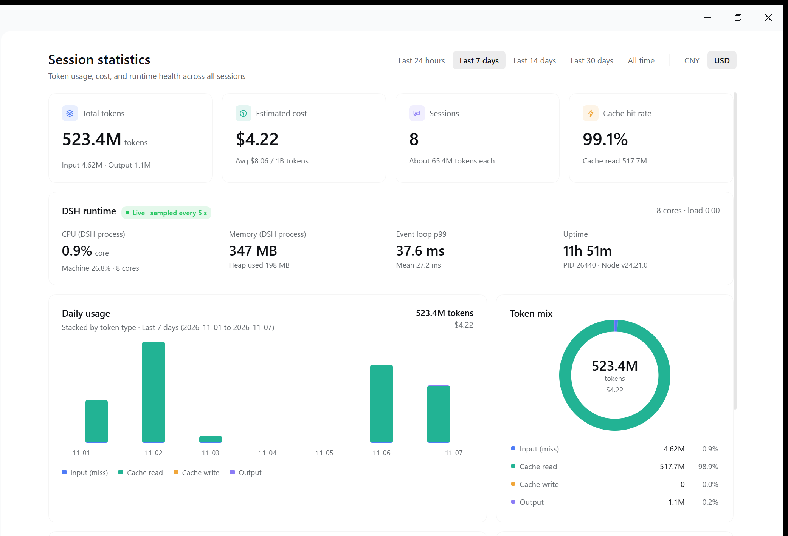
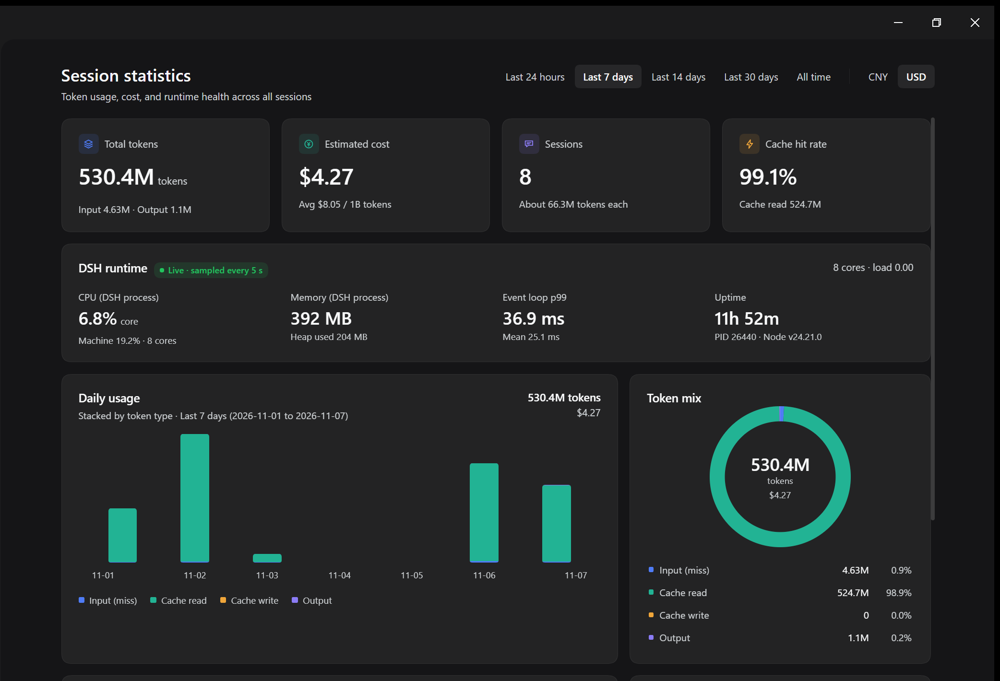

<div align="center">

# 📊 DSH Session Stats Viewer

[English](./README.en.md) | [简体中文](./README.md)

A **DeepSeek Harness (DSH)** plugin that adds a **Session statistics** page to the Web sidebar: token usage, estimated cost, cache hit rate, daily usage, session ranking, conversation performance, and DSH runtime health.

[](https://github.com/deepseek-ai/deepseek-harness)
[](./LICENSE)

[](https://nodejs.org)
[](https://conventionalcommits.org)

> DSH plugin · read-only statistics · no extra service · no third-party dependencies

</div>

## ✨ Features

- 📈 **Overview** – total tokens, estimated cost, session count, and cache hit rate for the last 24 hours / 7 / 14 / 30 days or all time.
- 💰 **Readable average price** – automatically scales the unit across `1M / 10M / 100M / 1B tokens` so the number stays meaningful.
- 💱 **Default currency follows the language** – Chinese opens in CNY, every other language opens in USD; a manual switch is kept for the current visit.
- 🗓️ **Daily usage** – stacked bars for input miss, cache read, cache write, and output tokens; hover any bar for the full date and breakdown.
- 🏆 **Session ranking** – sort by tokens, turn time, or cost; the primary number follows the selected sort, and each row shows its workspace and turn count.
- ⚡ **Conversation performance** – average turn, first-token latency, output speed, and tool error rate.
- 🖥️ **DSH runtime** – process CPU (per core and machine-wide), RSS / heap, event-loop p99, uptime, PID, and Node version, sampled every 5 seconds.
- 🎯 **Titles match the sidebar** – titles come from DSH's `title` projection instead of raw logs or the first message.
- 🌐 **Follows the DSH language** – the sidebar entry and page copy follow Settings → General → Language, with Simplified Chinese, English, Japanese, Spanish, French, German, Russian, and Portuguese dictionaries.
- 🚀 **Snapshot first, then incremental refresh** – the page paints the previous snapshot immediately and re-reads only changed Sessions in the background.

## 🖼️ Screenshot

| Light | Dark |
| --- | --- |
|  |  |

## 📁 Project structure

```text
dsh-session-stats-viewer/
├── src/
│   ├── index.js            # Host: log fold, snapshot cache, runtime sampler, /api route
│   └── client.js           # Client: sidebar icon and statistics page (single browser module)
├── test/
│   └── stats.test.js       # Fold, range, average-price, and workspace tests
├── locale/
│   ├── en.json             # Plugin display metadata (English)
│   └── zh.json             # Plugin display metadata (Chinese)
├── docs/
│   └── screenshots/        # README screenshots
├── cordis.patch.yml        # Inserts the Host plugin row
├── icon.svg                # Plugin artwork
├── package.json
├── LICENSE
├── README.md
├── README.en.md
└── CONTRIBUTING.md
```

- **No build step** – both halves are plain JavaScript loaded directly.
- **No runtime dependencies** – only Node built-ins and DSH services.
- **Strictly read-only** – never appends, edits, archives, or deletes Session data.

## 🚀 Installation

### Requirements

- DeepSeek Harness (DSH) Desktop or Web GUI with a Web-enabled profile
- No extra service or API key
- Node.js ≥ 20 for development and tests only

### Option 1: let the DSH agent install it (recommended)

1. Clone the repository to a stable directory (not a temporary downloads folder):

```bash
git clone https://github.com/Bright9025/dsh-session-stats-viewer.git
```

2. In a DSH conversation, send (replace the path with yours):

> Install this directory as a local bundle: `C:\path\to\dsh-session-stats-viewer`

The agent calls `plugin_manager install_bundle` for you. The install belongs to the current profile and applies to every Session in it.

3. Refresh the DSH page. **Session statistics** appears in the left sidebar below **Automation**.

### Option 2: install through the plugin manager

If your DSH build offers a local-directory install entry, open **Settings → Plugins**, choose the local install, and point it at the repository directory. The result is the same as Option 1.

### Verify the installation

- A **Session statistics** entry appears in the left sidebar;
- The plugin is listed under **Settings → Plugins**;
- Opening the page shows total tokens, estimated cost, and recent session data.

If the entry is missing, refresh the page first; restart DSH if it still does not appear.

### Upgrade and uninstall

- **Upgrade**: `git pull`, then reinstall the directory (uninstall and install again, or ask the agent to run `install_bundle` again).
- **Uninstall**: **Settings → Plugins → Session statistics → Uninstall**. Uninstalling removes the plugin only; it never deletes Session data.

> The plugin is installed from a local directory and is not published to npm. Node.js is only needed for tests, not for installation or use.

## 🧭 Usage

1. Click **Session statistics** in the left sidebar.
2. Switch the time range and currency at the top. Chinese opens in CNY; other languages open in USD.
3. Hover a bar for the full date and the four token kinds.
4. Switch the ranking between **By tokens / By time / By cost**; click a row to open that Session.
5. The page refreshes every 20 seconds and immediately after a range change.

## ⚙️ Configuration

Costs are **estimates**. Default prices (CNY per 1M tokens) live in `cordis.patch.yml`:

| Field | Default | Meaning |
| --- | --- | --- |
| `input` | 0.5 | uncached input |
| `cacheRead` | 0.05 | cache-read input |
| `cacheWrite` | 0.5 | cache-write input |
| `output` | 2 | output |
| `cnyPerUsd` | 7.2 | CNY per US dollar |

To override, add a matching entry for `session-stats-page` in the profile's `cordis.patch.yml`
(a matching override replaces the complete config, so include every field), then restart DSH.

## 🧠 How it works

- **Source of truth**: the Host reads Session logs through `ctx.sessionQuery` and folds them into hourly token / turn-time / first-token / tool-result buckets.
- **Titles**: read from `ctx.sessionQuery.observeSession(...).projections.values.title`, the same `title` projection the sidebar uses.
- **Workspaces**: the Session `cwd` is matched against `ctx.workspaceRegistry.list()`.
- **Incremental folds**: each Session fold is cached by its `ctx.sessionPersistence` revision, so a refresh only re-reads changed Sessions.
- **Snapshot**: the full fold is written to `$DSH_HOME/cache/session-stats/fold-v2.json`; after a restart the page shows it first, then refreshes in the background.
- **Endpoint**: `POST /api/session-stats.data`, mounted behind DSH's browser authentication, returns only the selected range's aggregate view.
- **Client**: registered in the `sidebar.panellist` and `main` slots and styled with DSH theme tokens; no external UI library.

## ⚠️ Limitations

- **Costs are estimates** based on token prices, not an actual bill.
- **Runtime metrics describe the DSH process**, not the whole machine; only the "Machine" CPU line is machine-wide.
- **First cold start is slower** when no snapshot exists; later starts paint the snapshot first.
- **All time starts at the earliest record**; with only 21 days of history it is shorter than the fixed 30-day window, though the totals are identical.
- **Workspace labels need a `cwd` match**; unmatched Sessions show only the turn count.

## 🧪 Development

```bash
npm test
```

Tests use Node's built-in `node:test` and cover folding, time ranges, average price, workspace mapping, empty data, and the key/placeholder completeness of all eight locale dictionaries.

Manual verification:

1. Install the folder as a local bundle in a test profile;
2. Open **Session statistics** and check ranges, the three sorts, hover details, and the currency switch;
3. Restart DSH and confirm the first paint comes from the snapshot before refreshing.

## 🙏 Inspiration and credits

The idea and UI design for this plugin come from the official DeepSeek Harness Bilibili video **"大家好，这里是 DeepSeek Harness，正式入驻 B 站！"** ("Hello everyone, this is DeepSeek Harness, officially joining Bilibili!") at **01:21**, where the original **Session statistics** panel is shown.

- [Chinese version (01:21)](https://www.bilibili.com/video/BV1i24P6rEmt/?share_source=copy_web&vd_source=1ef93e8537ab9d0874fa2d209de81fd0&t=81)
- [English version (01:21)](https://www.bilibili.com/video/BV1i24P6rEmt/?p=2&share_source=copy_web&vd_source=1ef93e8537ab9d0874fa2d209de81fd0&t=81)

This project is an independent community implementation and is not affiliated with the video authors or DeepSeek. The interface is a functional and visual reference only; no assets or code from the video were copied.

## 📄 License

[MIT License](./LICENSE).

## 🤝 Contributing

Issues and pull requests are welcome. Please read [CONTRIBUTING.md](./CONTRIBUTING.md) first.

## 📧 Contact

- Bugs / feature requests: GitHub Issues
- Security reports: contact the maintainer privately; do not post exploit details in a public issue
