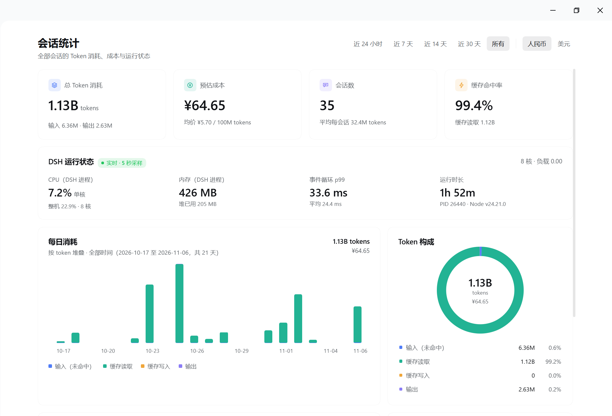
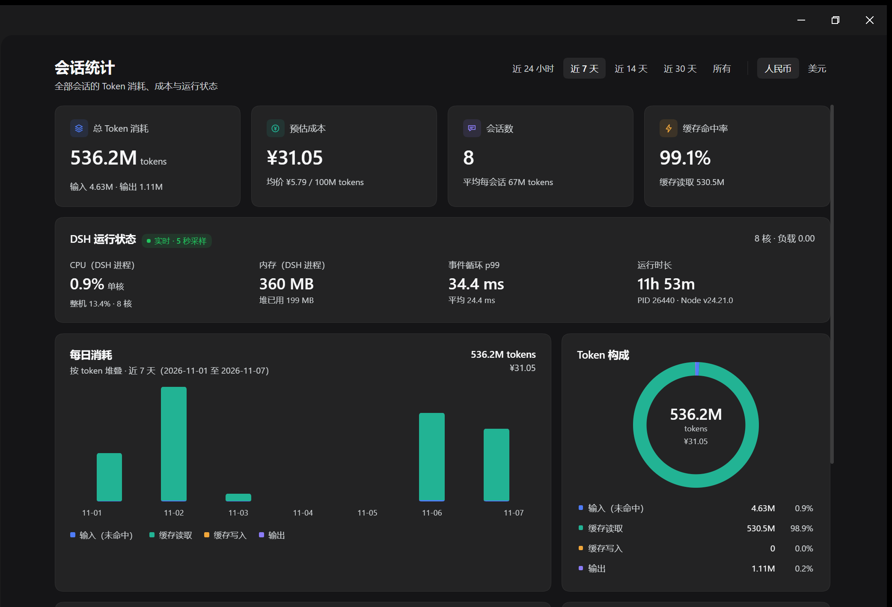

<div align="center">

# 📊 DSH Session Stats Viewer

[English](https://github.com/Bright9025/dsh-session-stats-viewer/blob/main/README.en.md) | [简体中文](https://github.com/Bright9025/dsh-session-stats-viewer/blob/main/README.md)

为 **DeepSeek Harness（DSH）** 的 Web 侧边栏增加一个「会话统计」页：汇总全部会话的 Token 消耗、预估成本、缓存命中、每日用量、会话排行、对话性能与 DSH 运行时状态。

[](https://github.com/deepseek-ai/deepseek-harness)
[](https://www.npmjs.com/package/@bright9025/dsh-session-stats-viewer)
[](https://github.com/Bright9025/dsh-session-stats-viewer/blob/main/LICENSE)

[](https://nodejs.org)
[](https://conventionalcommits.org)

> DSH 插件 · 只读统计 · 无额外服务 · 无第三方依赖

</div>

## ✨ 功能特点

- 📈 **总览指标** – 总 Token、预估成本、会话数、缓存命中率，支持近 24 小时 / 7 天 / 14 天 / 30 天 / 所有。
- 💰 **可读的均价** – 按已用量自动选择 `1M / 10M / 100M / 1B tokens` 单位，避免出现 `¥0.00` 这类无意义数字。
- 💱 **默认货币跟随语言** – 中文界面默认人民币，其他语言默认美元；手动切换后本次停留期间保持手动选择。
- 🗓️ **每日消耗** – 输入 / 缓存读取 / 缓存写入 / 输出四类 Token 堆叠柱状图，悬停查看完整日期与拆分。
- 🏆 **会话消耗排行** – 按 Token、按耗时、按金额三种排序；主数字跟随所选指标，并显示所属工作区与轮次。
- ⚡ **对话性能** – 平均每轮耗时、平均首字延迟、输出速度、工具错误率。
- 🖥️ **DSH 运行状态** – 进程 CPU（单核与整机）、内存 RSS / 堆、事件循环 p99、运行时长、PID 与 Node 版本，每 5 秒采样。
- 🎯 **标题与侧边栏一致** – 标题取自 DSH 的 `title` 投影，而不是原始日志或首条消息。
- 🌐 **跟随 DSH 语言** – 侧边栏入口与页面文案跟随「设置 → 通用设置 → 语言」，内置中文、English、日本語、Español、Français、Deutsch、Русский、Português 八种字典。
- 🚀 **缓存先行 + 增量刷新** – 首屏直接显示上次快照，后台只重读有变化的会话。

## 🖼️ 界面

| 浅色 | 深色 |
| --- | --- |
|  |  |

## 📁 项目结构

```text
dsh-session-stats-viewer/
├── src/
│   ├── index.js            # Host：日志折叠、快照缓存、运行时采样、/api 路由
│   └── client.js           # Client：侧边栏图标与统计页面（单文件浏览器模块）
├── test/
│   └── stats.test.js       # 折叠、范围、均价、工作区映射的单元测试
├── locale/
│   ├── en.json             # 插件展示元数据（英文）
│   └── zh.json             # 插件展示元数据（中文）
├── docs/
│   └── screenshots/        # README 截图
├── cordis.patch.yml        # 插入 Host 插件行
├── icon.svg                # 插件图标
├── package.json
├── LICENSE
├── README.md
├── README.en.md
└── CONTRIBUTING.md
```

- **无构建步骤**：Host 与 Client 都是可直接加载的纯 JavaScript。
- **无运行时依赖**：只使用 Node 内置模块与 DSH 提供的服务。
- **只读**：不会写入、修改、归档或删除任何会话数据。

## 🚀 安装

### 环境要求

- DeepSeek Harness（DSH）Desktop 或 Web GUI，且当前 profile 具备 Web 界面
- 无需额外服务或 API Key
- 仅开发/测试需要 Node.js ≥ 20

### 方式一：从 npm 安装（推荐）

```bash
dsh plugin --profile <profile> add @bright9025/dsh-session-stats-viewer
```

包地址：<https://www.npmjs.com/package/@bright9025/dsh-session-stats-viewer>

也可以在 DSH 对话里直接说：

> 安装 npm 包 `@bright9025/dsh-session-stats-viewer`

安装完成后刷新 DSH 页面。左侧边栏「自动化任务」下方会出现 **会话统计**。

### 方式二：从源码安装（开发）

1. 克隆仓库到一个固定目录（不要放在临时下载目录）：

```bash
git clone https://github.com/Bright9025/dsh-session-stats-viewer.git
```

2. 在 DSH 对话中发送（把路径换成你的实际路径）：

> 把这个目录安装为本地 bundle：`C:\path\to\dsh-session-stats-viewer`

智能体会调用 `plugin_manager install_bundle`。本地源码安装适合调试，npm 安装适合日常使用；两者不要同时装。

### 安装后检查

- 左侧边栏出现「会话统计」；
- 设置 → 插件中能看到该插件；
- 打开页面后能看到总 Token、预估成本与最近的会话数据。

如果入口没有出现：先刷新页面；仍然没有就重启 DSH。

### 升级与卸载

- **升级**：有新版后重新安装（先卸载旧版，再执行上面的安装命令）；源码方式则 `git pull` 后重装。
- **卸载**：设置 → 插件 → 会话统计 → 卸载。卸载只移除插件，不会删除任何会话数据。

> 已发布到 npm；使用和安装不需要 Node.js，Node.js 仅用于跑测试。

## 🧭 使用

1. 点击左侧边栏的 **会话统计**。
2. 顶部切换时间范围与货币（人民币 / 美元）。人民币界面默认人民币，其他语言默认美元。
3. 柱状图悬停查看某一天的完整日期与四类 Token 拆分。
4. 会话排行可切换 **按 Token / 按耗时 / 按金额**，点击任一行直接打开该会话。
5. 页面每 20 秒自动刷新；切换范围会立即重新取数。

## ⚙️ 配置

成本为**估算值**，默认单价（人民币 / 百万 Token）写在 `cordis.patch.yml`：

| 字段 | 默认值 | 含义 |
| --- | --- | --- |
| `input` | 0.5 | 未命中缓存的输入 |
| `cacheRead` | 0.05 | 缓存读取 |
| `cacheWrite` | 0.5 | 缓存写入 |
| `output` | 2 | 输出 |
| `cnyPerUsd` | 7.2 | 人民币 / 美元换算 |

需要修改时，在 profile 的 `cordis.patch.yml` 中覆盖 `session-stats-page` 行（会替换整份 config，请把全部字段写全），然后重启 DSH：

```yaml
- id: session-stats-page
  config:
    pricing:
      input: 0.5
      cacheRead: 0.05
      cacheWrite: 0.5
      output: 2
      cnyPerUsd: 7.2
```

## 🧠 实现说明

- **数据来源**：Host 通过 `ctx.sessionQuery` 读取会话日志，折叠成按小时的 Token / 耗时 / 首字延迟 / 工具结果桶。
- **标题**：通过 `ctx.sessionQuery.observeSession(...).projections.values.title` 读取，与侧边栏使用同一份 `title` 投影。
- **工作区**：用会话的 `cwd` 匹配 `ctx.workspaceRegistry.list()`，得到侧边栏中的工作区名。
- **增量折叠**：每个会话的折叠结果按 `ctx.sessionPersistence` 的 revision 缓存；刷新时只重读有变化的会话。
- **快照**：完整折叠写入 `$DSH_HOME/cache/session-stats/fold-v2.json`；重启后首屏先显示该快照，再后台增量刷新。
- **接口**：`POST /api/session-stats.data`，经 DSH 的浏览器鉴权挂载，只返回所选时间范围的聚合视图。
- **客户端**：注册到 `sidebar.panellist` 与 `main` 插槽，使用 DSH 主题变量，不引入外部 UI 库。

## ⚠️ 已知限制

- **成本是估算**：按 Token 单价计算，不代表真实账单。
- **运行状态只描述 DSH 进程**：CPU / 内存为 DSH 自身；「整机」那一行才是所有核心的总 CPU。
- **首次冷启动较慢**：没有快照时需完整折叠一次；之后启动先显示快照。
- **「所有」从最早记录开始**：如果历史只有 21 天，它会比「近 30 天」的固定窗口短，但总量相同。
- **工作区标签依赖 `cwd` 匹配**：会话目录不在任何已注册工作区时，只显示轮次。
- **工具错误率**按 `tool/result` 中带 `error` 的记录统计。

## 🧪 开发与测试

```bash
npm test
```

测试使用 Node 内置 `node:test`，覆盖折叠、时间范围、均价、工作区映射、空数据，以及八种语言字典的键与占位符完整性。

手动验证：

1. 把仓库作为本地 bundle 安装到测试 profile；
2. 打开「会话统计」，检查各范围、三种排行、悬停详情与货币切换；
3. 重启 DSH，确认首屏来自快照且随后自动刷新。

## 🙏 灵感与致谢

本插件的灵感与 UI 设计来源于 DeepSeek Harness 官方 B 站视频 **《大家好，这里是 DeepSeek Harness，正式入驻 B 站！》** 的 **01:21** 处（视频中展示的「会话统计 / Session statistics」面板）。

- [中文版视频（01:21）](https://www.bilibili.com/video/BV1i24P6rEmt/?share_source=copy_web&vd_source=1ef93e8537ab9d0874fa2d209de81fd0&t=81)
- [English version（01:21）](https://www.bilibili.com/video/BV1i24P6rEmt/?p=2&share_source=copy_web&vd_source=1ef93e8537ab9d0874fa2d209de81fd0&t=81)

本项目是社区独立实现，与视频作者及 DeepSeek 官方没有隶属关系；界面仅作功能与视觉参考，未复制视频中的任何素材或代码。

## 📄 许可证

本项目采用 [MIT License](https://github.com/Bright9025/dsh-session-stats-viewer/blob/main/LICENSE) 开源。

## 🤝 贡献

欢迎提交 Issue 或 Pull Request。请先阅读 [CONTRIBUTING.md](https://github.com/Bright9025/dsh-session-stats-viewer/blob/main/CONTRIBUTING.md)。

## 📧 联系方式

- Bug / 功能建议：GitHub Issues
- 安全问题：请通过 GitHub 私下联系维护者，不要在公开 Issue 中贴出利用细节
